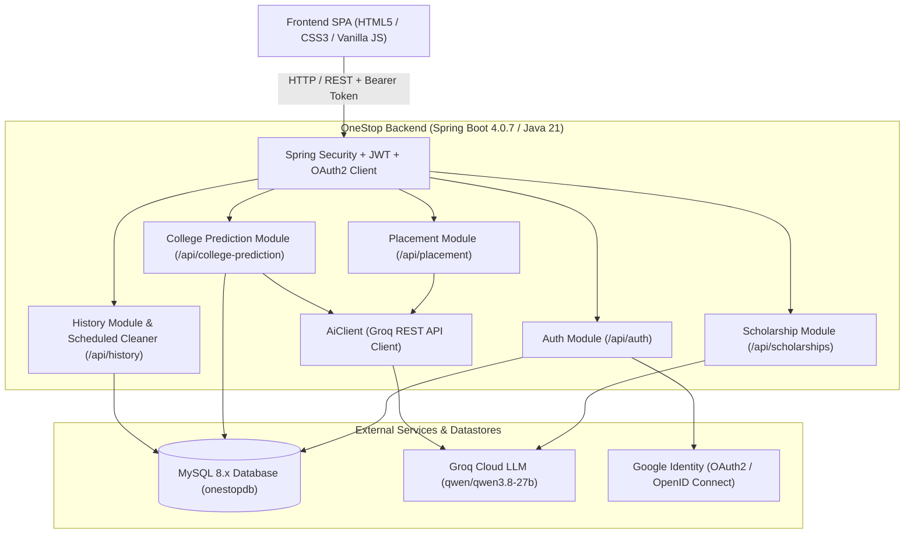
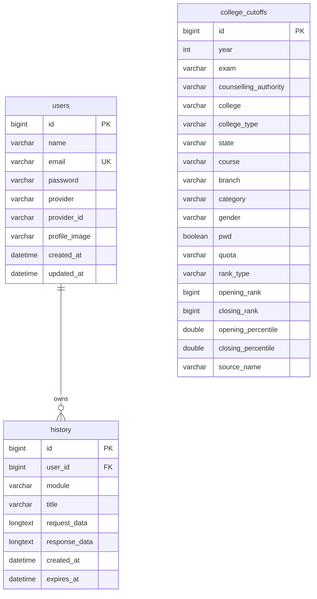

# OneStop — AI-Powered Student Career & Academic Navigator

<p align="center">
  
  
  
  
  
  
</p>

---

## 📌 Table of Contents

- [Overview](#-overview)
- [System Architecture](#-system-architecture)
- [Key Features](#-key-features)
  - [1. Placement Preparation Engine](#1-ai-placement-preparation-engine)
  - [2. Scholarship Discovery Finder](#2-smart-scholarship-discovery-finder)
  - [3. College Predictor & Cutoff Engine](#3-college-prediction--cutoff-analyzer)
  - [4. Auth & Security (JWT + OAuth2)](#4-enterprise-authentication--security)
  - [5. History & Automated Lifecycle Management](#5-user-history--scheduled-lifecycle)
- [Tech Stack](#-tech-stack)
- [Project Directory Structure](#-project-directory-structure)
- [REST API Reference](#-rest-api-reference)
- [Database Schema](#-database-schema)
- [Getting Started & Local Setup](#-getting-started--local-setup)
  - [Prerequisites](#prerequisites)
  - [1. Clone Repository](#1-clone-repository)
  - [2. Database Setup](#2-database-setup)
  - [3. Environment Configuration](#3-environment-configuration)
  - [4. Run Backend](#4-run-backend)
  - [5. Import JoSAA Cutoffs Dataset](#5-import-josaa-cutoffs-dataset-optional-first-run)
  - [6. Launch Frontend](#6-launch-frontend)
- [Environment Variables Guide](#-environment-variables-guide)
- [Contributing](#-contributing)
- [License](#-license)

---

## 🚀 Overview

**OneStop** is an intelligent, unified web platform engineered to eliminate information asymmetry for college students and aspirants. It combines **Spring Boot**, **MySQL**, **Groq Cloud AI (Qwen 3.8 27B)**, and a **modern responsive SPA** to deliver three core pillars of student success:

1. **AI-Driven Placement Preparation**: Personalized, day-by-day technical roadmap generation with interview questions, priority focus areas, and hiring stage breakdowns for specific target companies and roles.
2. **Scholarship Discovery Finder**: Intelligent matching of eligible government and private scholarships based on category, gender, income, state, and academic background.
3. **College Cutoff Predictor**: Accurate admission chance forecasting utilizing a dataset of historical **JoSAA (IIT/NIT/IIIT/GFTI)** cutoffs combined with AI-backed strategic recommendations.

---

## 🏛️ System Architecture



---

## 🌟 Key Features

### 1. AI Placement Preparation Engine
- **Targeted Roadmap Generator**: Calculates day-by-day study plans customized to the candidate's target company (e.g., Google, Amazon, Juspay), target job role (e.g., SDE-1, Data Engineer), and available preparation time (in days).
- **Core Skills Breakdown**: Outlines programming languages, frameworks, system design concepts, and database fundamentals required.
- **Hiring Stage Blueprint**: Details every round from Online Assessments (OA) to technical deep-dives and behavioral rounds.
- **Previously Asked Questions**: Curates verified interview questions with hints and topics.
- **Groq JSON Mode**: Powered by `qwen/qwen3.8-27b` with temperature `0.2` and strict JSON output schemas for reliable client-side rendering.

### 2. Smart Scholarship Discovery Finder
- **Profile Matching**: Evaluates category (GEN, OBC, SC, ST, EWS), gender, family annual income slab, state of domicile, and current academic discipline.
- **Comprehensive Listings**: Returns verified national, state, and corporate scholarship schemes with eligibility criteria, award amounts, deadlines, and direct application links.

### 3. College Prediction & Cutoff Analyzer
- **JoSAA Cutoff Database**: Preloaded with a multi-year JoSAA dataset covering opening and closing ranks for IITs, NITs, IIITs, and GFTIs.
- **Flexible Search Criteria**: Filters by Exam (`JEE Main`, `JEE Advanced`), Rank, Quota (`AI - All India`, `HS - Home State`, `OS - Other State`), Category, and Gender.
- **Target College Feasibility**: Computes whether an applicant's dream college is `SAFE`, `TARGET`, or `REACH` and suggests alternative campuses.
- **Automated Ingestion**: REST endpoint to ingest and index historical JoSAA CSV records into MySQL (`/api/college-cutoffs/import/josaa`).

### 4. Enterprise Authentication & Security
- **Dual Authentication**:
  - **Local**: Email/password signup with BCrypt password hashing.
  - **Google OAuth2**: One-click Google Social Sign-In via OpenID Connect with custom success handlers (`OAuth2SuccessHandler`) returning JWTs to the frontend.
- **Stateless JWT**: Bearer token authentication implemented with custom `JwtAuthenticationFilter` and `RestAuthenticationEntryPoint`.
- **CORS Configured**: Built-in support for local frontend servers (`localhost:5500` / `127.0.0.1:5500`).

### 5. User History & Scheduled Lifecycle
- **Automatic History Logging**: Automatically stores placement plans, scholarship queries, and college predictions for authenticated users.
- **Guest Friendly**: Core search & prediction features remain fully usable by unauthenticated guests.
- **Automated TTL Purge**: A scheduled cron service (`HistoryCleanupService`) runs daily at 2:00 AM (`0 0 2 * * *`) to safely delete expired records older than 7 days.

---

## 🛠️ Tech Stack

| Layer | Technology | Details |
|---|---|---|
| **Language** | Java 21 | Modern LTS Java release |
| **Framework** | Spring Boot 4.0.7 | Spring MVC, Spring Data JPA, Spring Security |
| **Security** | Spring Security 6 + JJWT | Stateless JWT + Google OAuth2 Client |
| **AI / LLM** | Groq Cloud API | Model: `qwen/qwen3.8-27b` via Spring `RestClient` |
| **Database** | MySQL 8.x | Hibernate ORM / JPA with automated DDL updates |
| **CSV Parser** | Apache Commons CSV 1.14.1 | High-throughput streaming ingestion for cutoffs |
| **Build Tool** | Apache Maven | Maven Wrapper (`mvnw` / `mvnw.cmd`) |
| **Frontend** | HTML5, CSS3, Vanilla JavaScript | Responsive SPA with tabbed navigation & modals |

---

## 📂 Project Directory Structure

```plaintext
OneStop/
├── .env.example                               # Sample environment variables template
├── .gitignore                                 # Git ignore rules
├── pom.xml                                    # Maven dependencies & build configuration
├── mvnw / mvnw.cmd                            # Maven wrapper executables
├── frontend/                                  # Frontend Single Page Application
│   ├── index.html                             # Main dashboard interface
│   ├── oauth2-success.html                    # Google OAuth2 redirect token handler
│   ├── css/
│   │   └── style.css                          # Application styling & responsive layouts
│   └── js/
│       ├── app.js                             # Placement, Scholarship, College & History UI logic
│       └── auth.js                            # JWT auth, user profile, and modal state management
└── src/
    ├── main/
    │   ├── java/com/project5/OneStop/
    │   │   ├── OneStopApplication.java        # Spring Boot entry point (@EnableScheduling)
    │   │   ├── auth/                          # Authentication, JWT, OAuth2, and User domain
    │   │   │   ├── controller/AuthController.java
    │   │   │   ├── dto/                       # LoginRequest, SignupRequest, AuthResponse, etc.
    │   │   │   ├── entity/                    # User, AuthProvider
    │   │   │   ├── oauth2/                    # OAuth2SuccessHandler, OAuth2FailureHandler
    │   │   │   ├── repository/UserRepository.java
    │   │   │   ├── security/                  # SecurityConfig, JwtService, JwtFilter
    │   │   │   └── service/AuthService.java
    │   │   ├── collegeprediction/             # College prediction & cutoff importer
    │   │   │   ├── controller/CollegePredictionController.java
    │   │   │   ├── controller/CollegeCutoffImportController.java
    │   │   │   ├── dto/                       # CollegePredictionRequest, CollegeResult, etc.
    │   │   │   ├── entity/CollegeCutoff.java
    │   │   │   ├── importer/                  # JosaaCutoffImporter, CutoffCsvImporter
    │   │   │   ├── repository/CollegeCutoffRepository.java
    │   │   │   └── service/                   # CollegePredictionService, CollegeAiService
    │   │   ├── common/ai/                     # Shared Groq AI client & RestClient configs
    │   │   │   ├── AiClient.java
    │   │   │   └── AiClientConfig.java
    │   │   ├── history/                       # User activity audit & scheduled cleanup
    │   │   │   ├── controller/HistoryController.java
    │   │   │   ├── dto/HistoryResponse.java
    │   │   │   ├── entity/History.java
    │   │   │   ├── repository/HistoryRepository.java
    │   │   │   └── service/                   # HistoryService, HistoryCleanupService
    │   │   ├── placement/                     # Placement preparation roadmap engine
    │   │   │   ├── controller/PlacementController.java
    │   │   │   ├── dto/                       # PlacementRequest, PlacementPlanResponse, etc.
    │   │   │   └── service/PlacementService.java
    │   │   └── scholarship/                   # Scholarship matcher & Groq AI analyzer
    │   │       ├── controller/ScholarshipController.java
    │   │       ├── dto/                       # ScholarshipRequest, ScholarshipResponse, etc.
    │   │       └── service/ScholarshipService.java
    │   └── resources/
    │       ├── application.properties         # Spring Boot configuration
    │       └── data/
    │           └── josaa_cutoffs.csv          # Historical JoSAA rank cutoff dataset (~73 MB)
    └── test/                                  # Unit and integration test suite
```

---

## 📡 REST API Reference

### 1. Authentication (`/api/auth`)
| Method | Endpoint | Access | Description |
|---|---|---|---|
| `POST` | `/api/auth/signup` | Public | Register a new user account |
| `POST` | `/api/auth/login` | Public | Authenticate user credentials & retrieve JWT token |
| `GET` | `/api/auth/me` | Authenticated | Retrieve profile details of currently logged-in user |
| `GET` | `/oauth2/authorization/google` | Public | Initiate Google OAuth2 login flow |

### 2. Placement Preparation (`/api/placement`)
| Method | Endpoint | Access | Description |
|---|---|---|---|
| `POST` | `/api/placement/generate` | Public / Auth | Generate comprehensive prep plan & roadmap with AI |

### 3. Scholarship Finder (`/api/scholarships`)
| Method | Endpoint | Access | Description |
|---|---|---|---|
| `POST` | `/api/scholarships/find` | Public / Auth | Match and retrieve eligible scholarship schemes |

### 4. College Prediction & Cutoffs (`/api/college-prediction`, `/api/college-cutoffs`)
| Method | Endpoint | Access | Description |
|---|---|---|---|
| `POST` | `/api/college-prediction/predict` | Public / Auth | Predict eligible colleges & get AI guidance |
| `POST` | `/api/college-cutoffs/import/josaa` | Public | Trigger ingestion of classpath JoSAA CSV into MySQL |

### 5. User Activity History (`/api/history`)
| Method | Endpoint | Access | Description |
|---|---|---|---|
| `GET` | `/api/history` | Authenticated | Fetch activity history for the current user |
| `DELETE` | `/api/history/{id}` | Authenticated | Delete a specific history entry |

---

## 🗄️ Database Schema



---

## 💻 Getting Started & Local Setup

### Prerequisites
- **JDK 21** or later installed ([Adoptium Temurin](https://adoptium.net/) or [Oracle JDK](https://www.oracle.com/java/technologies/downloads/))
- **MySQL 8.0+** running locally
- **Groq Cloud API Key** (Free tier available at [console.groq.com](https://console.groq.com/keys))
- **Google Cloud Console OAuth2 Credentials** (Optional, required only for Google Sign-In)

---

### 1. Clone Repository
```bash
git clone https://github.com/kundankeshrii/OneStop.git
cd OneStop
```

### 2. Database Setup
Create the MySQL database:
```sql
CREATE DATABASE onestopdb;
```
*(Tables and schema indexes are automatically generated and updated by Hibernate when Spring Boot starts).*

### 3. Environment Configuration
Copy the template configuration file:
```bash
cp .env.example .env
```
Open `.env` (or configure your system environment variables) with your credentials:
```env
DB_URL=jdbc:mysql://localhost:3306/onestopdb
DB_USERNAME=root
DB_PASSWORD=your_mysql_password

GROQ_API_KEY=gsk_your_groq_api_key_here
GOOGLE_CLIENT_ID=your_client_id.apps.googleusercontent.com
GOOGLE_CLIENT_SECRET=your_client_secret_here
```

### 4. Run Backend
Using the included Maven wrapper:

**On Linux/macOS:**
```bash
./mvnw clean spring-boot:run
```

**On Windows (PowerShell / Command Prompt):**
```powershell
.\mvnw.cmd clean spring-boot:run
```
The backend server will start on port `8080` (`http://localhost:8080`).

### 5. Import JoSAA Cutoffs Dataset (Optional / First Run)
To populate MySQL with the historical JoSAA cutoffs bundled in `src/main/resources/data/josaa_cutoffs.csv`:
```bash
curl -X POST http://localhost:8080/api/college-cutoffs/import/josaa
```
*Note: This parses previous-year JoSAA ranks and stores aggregated cutoffs directly into your database.*

### 6. Launch Frontend
The frontend consists of static HTML, CSS, and JS files located in `/frontend`. Serve them with any local web server on port `5500`:
- **VS Code**: Right-click `frontend/index.html` -> **Open with Live Server**.
- **Python**:
  ```bash
  cd frontend
  python -m http.server 5500
  ```
- **Node.js (http-server / serve)**:
  ```bash
  npx serve frontend -p 5500
  ```
Visit `http://localhost:5500` or `http://127.0.0.1:5500` in your web browser.

---

## ⚙️ Environment Variables Guide

| Variable | Description | Default / Example |
|---|---|---|
| `DB_URL` | JDBC Connection URL for MySQL | `jdbc:mysql://localhost:3306/onestopdb` |
| `DB_USERNAME` | MySQL username | `root` |
| `DB_PASSWORD` | MySQL password | *(blank / your password)* |
| `GROQ_API_KEY` | API Key from Groq Cloud | `gsk_...` |
| `GOOGLE_CLIENT_ID` | OAuth2 Client ID from Google Cloud Console | `...apps.googleusercontent.com` |
| `GOOGLE_CLIENT_SECRET`| OAuth2 Client Secret from Google Cloud Console | `GOCSPX-...` |
| `JWT_SECRET` | Secret key used for signing JWT tokens | *(32+ characters string)* |

---

## 🤝 Contributing

Contributions, issues, and feature requests are welcome!

1. Fork the repository
2. Create your feature branch (`git checkout -b feature/AmazingFeature`)
3. Commit your changes (`git commit -m 'feat: Add some AmazingFeature'`)
4. Push to the branch (`git push origin feature/AmazingFeature`)
5. Open a Pull Request

---

## 📄 License

This project is licensed under the [MIT License](LICENSE) (or applicable open-source license).

---

<p align="center">
  Crafted with ❤️ by <a href="https://github.com/kundankeshrii">Kundan Keshri</a>
</p>
